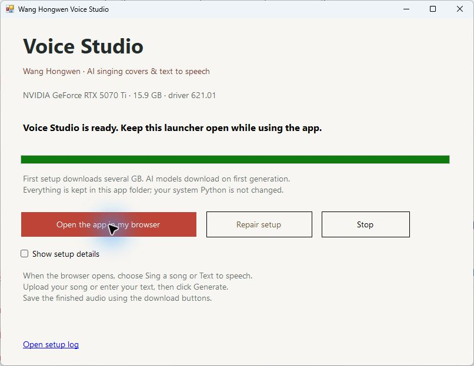

# 王洪文语音工作室 · Wang Hongwen Voice Studio

**简体中文** · [English](README.en.md) · [中文安装与使用手册](docs/Windows-Setup.zh-CN.md) · [版本更新](CHANGELOG.md)

基于历史讲话参考音频的开源 AI 歌曲翻唱与文字转语音工具。上传一首有人声的歌曲，或输入一段文字，即可生成参考音色的 AI 演绎。

**[下载 Windows 版](https://github.com/2009Wu/wang-hongwen-voice/releases/latest/download/Wang-Hongwen-Voice-Studio-Windows.zip)** · [全部发布版本](https://github.com/2009Wu/wang-hongwen-voice/releases) · [Hugging Face 项目与语音示例](https://huggingface.co/spaces/Little-Wang/wang-hongwen-voice)

## Windows 新手：三步开始

1. 下载 **Wang-Hongwen-Voice-Studio-Windows.zip**，将整个 ZIP 解压到准备长期保留的文件夹。
2. 双击文件夹中的 **Start Voice Studio.exe**。
3. 点击 **Set up & open Voice Studio**（安装并打开），等待安装完成，浏览器会自动打开本地应用。

启动器会自动准备独立 Python、GPU 运行库、音频工具和应用环境，无需手动配置 Python、Docker 或终端命令。以后再次双击启动器，点击 **Open Voice Studio**（打开工作室）即可。

**当前 Windows 版要求：64 位 Windows 10/11、16 GB 级或更大显存的 NVIDIA 显卡、可用的 NVIDIA 驱动、至少 30 GB 剩余空间。** 8 GB 显存支持尚待验证；目前启动器仍按 16 GB 级检测。 首次安装以及第一次生成需要联网下载数 GB 文件，请耐心等待。具体步骤和常见问题见[中文手册](docs/Windows-Setup.zh-CN.md)。

当前应用和启动器的按钮仍以英文显示；中文手册提供了逐项对照。使用期间请保持启动器开启，并及时保存生成的文件。

查看启动器和应用截图

## 能做什么

- **歌曲翻唱**：上传带人声的歌曲或音乐视频，自动分离伴奏、转换主唱、混音，导出 WAV 和 MP3；视频输入还可以导出替换音轨后的 MP4。
- **文字转语音**：输入文字，生成参考音色的语音。中文最接近原始参考讲话；模型同时提供其他受支持语言和自动语言选择。
- **人声更清楚**：默认保留原曲旋律和音高，使用人声均衡、轻度压缩和伴奏自动压低，让主唱更突出。
- **整首歌曲处理**：使用重叠分段处理整首歌曲，默认最长 10 分钟；文字默认最多 600 字符，限制可配置。

本项目使用参考音频条件生成，没有单独训练并发布“王洪文专用模型权重”。音色相似度会受到原始歌曲、文本和历史录音质量影响。纯伴奏输入不会自动创作歌词或唱腔。

## 怎么使用

### 生成歌曲翻唱

打开 **Sing a song**（歌曲翻唱）标签页，上传 MP3、WAV、M4A、MP4 等文件，点击 **Create AI cover**（生成 AI 翻唱）。完成后试听，使用下载按钮保存 WAV、MP3 或 MP4。

默认主唱音量为 **+4.5 dB**，伴奏为 **−1.5 dB**。想让人声更突出，可提高 **Lead vocal level**，或降低 **Instrumental level**。

### 生成文字语音

打开 **Text to speech**（文字转语音）标签页，输入文字，中文内容选择 **Chinese**，点击 **Generate speech**（生成语音），完成后下载音频。

首次生成会下载对应模型，比以后更慢。两个功能共用一个 GPU 队列，按顺序处理任务。网页的 **Stop** 停止当前生成；启动器的 **Stop** 停止本地服务。

## 当前版本与更新方法

当前 Windows 发布版为 **[v0.2.2：Windows 首次下载修复](https://github.com/2009Wu/wang-hongwen-voice/releases/tag/v0.2.2)**。修复 Windows 首次下载语音模型时可能出现的权限错误，保留中文快速开始、完整安装使用手册和更新日志。

程序目前不自动更新。安装新版本前，请先保存生成结果并关闭启动器，然后从 [Releases](https://github.com/2009Wu/wang-hongwen-voice/releases) 下载新 ZIP。完整的升级与模型缓存迁移步骤见[中文手册](docs/Windows-Setup.zh-CN.md#7-更新到新版本)，每个版本的变化见 [CHANGELOG.md](CHANGELOG.md)。

最新在线文档随主分支更新；历史 ZIP 以其对应发布内容为准。

## 开发者与其他部署方式

需要 Docker 或手动 Python 环境的开发者，请阅读 [English README](README.en.md) 和 [Dockerfile](Dockerfile)。界面、歌曲转换、文字语音分别使用独立 Python 环境，以避免依赖版本冲突。

验证结果见 [Windows 安装测试](docs/Windows-Validation.md) 和[原始应用测试记录](VALIDATION.md)。已在一台 Windows 11 / RTX 5070 Ti 电脑上完成全新应用环境安装、翻唱与中文语音生成测试；Docker 镜像仍未在该测试环境中构建运行。

Hugging Face 页面用于公开项目、源码和试听。下载后的模型生成在运行应用的电脑上进行；程序不会将用户上传的歌曲或输入文字交给其他推理 API。

## 开源许可与说明

项目软件采用 **GPL-3.0**，见 [LICENSE](LICENSE)。上游代码、模型来源和许可证见 [THIRD_PARTY_NOTICES.md](THIRD_PARTY_NOTICES.md) 与 [models.json](models.json)。

历史讲话参考录音**不包含在软件 GPL 授权范围内**，其来源信息和权利说明见 [assets/reference.json](assets/reference.json)。项目不声称拥有这些录音或授予新的再分发权利。

所有生成内容均为 **AI 合成演绎，并非王洪文真实录音或演唱**。分享结果时请保留 AI 合成标注。
