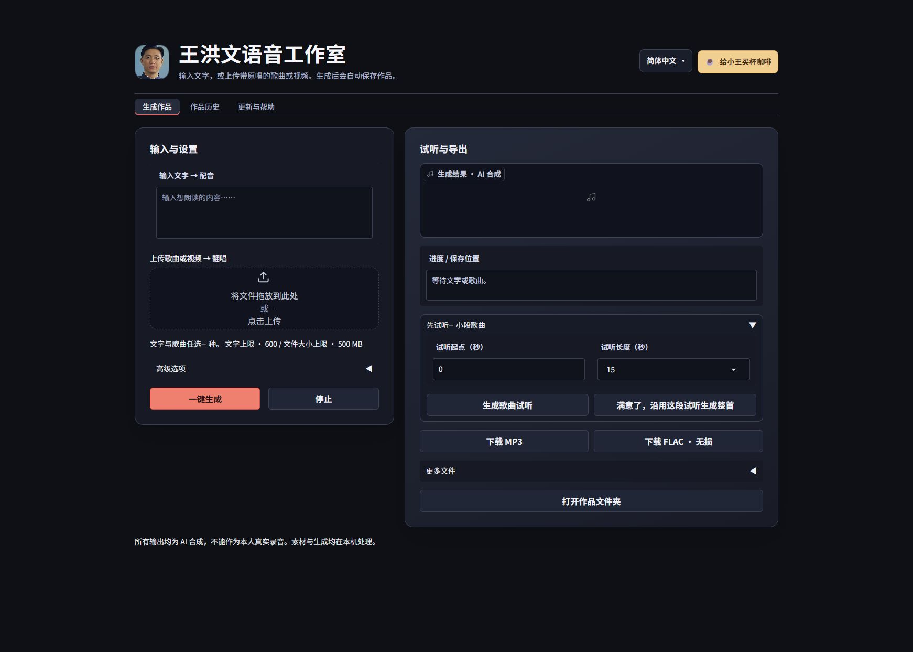

# 王洪文语音工作室 · Wang Hongwen Voice Studio

石墨蓝录音台，把试听控制集中到播放器旁。 右上角语言菜单列出全球使用人数最多的 20 种语言，普通话可选简体或繁体。切换语言会保留草稿。

[English](README.en.md) · [安装说明](docs/Windows-Setup.zh-CN.md) · [更新记录](CHANGELOG.md)

上传歌曲，或输入一段文字，制作以王洪文讲话为参考的翻唱和配音。支持 MP3、MP4 等音视频文件，在自己的 Windows 电脑上运行。

**[下载 Windows 版](https://github.com/2009Wu/wang-hongwen-voice/releases/latest/download/Wang-Hongwen-Voice-Studio-Windows.zip)** · [全部版本](https://github.com/2009Wu/wang-hongwen-voice/releases) · [Hugging Face 项目和试听](https://huggingface.co/spaces/Little-Wang/wang-hongwen-voice)

当前 Windows 版 **v0.5.6**。[版本说明](docs/releases/v0.5.6.md)

安装更新后，缺少的桌面快捷方式会自动补建。已有快捷方式会沿用，图标变更时会更新原图标。

双击桌面图标进入工作室。安装界面在工作室打开后会自动收起，关闭工作室会结束后台服务。

## 提交反馈

欢迎分享功能建议、程序问题，以及配音或翻唱质量上的意见。[打开反馈表单](https://github.com/2009Wu/custom-voice-studio/issues/new?template=studio-feedback.yml)（需登录 GitHub，内容公开）。

## 作品、试听和更新

启动时自动检查更新。有新版时，右下角会提醒，版本下方也会显示更新内容。在「更新与帮助」的版本下方或右下角提醒里，点击「安装更新并重启」即可完成升级。

生成后自动保存到“文档”，可在作品历史中找回。歌曲可先试听 10–20 秒，满意后沿用试听生成整首；不满意的区间可单独重做，原作品另行保留。

两个工作室共用本地模型缓存。程序内可以查看新版说明并一键安装重启；发生故障时可导出不含录音和输入文字的诊断报告。操作步骤和保存位置见 [作品与更新](docs/作品与更新.md)。

## 桌面一键打开

完整解压后首次运行启动器，会自动在当前用户桌面创建「王洪文语音工作室」快捷方式；安装成功后也会补建。以后双击桌面图标，程序自动启动本地服务并打开工作室窗口，无需再次点击「打开工作室」。重复点击会打开已有实例。首次使用仍需完成安装，单纯下载 ZIP 不会自动执行程序。

请保留完整程序文件夹。移动程序后，运行新位置的 EXE，或在启动器底部点击「创建 / 修复桌面快捷方式」。桌面权限受限时，快捷方式失败不会阻止安装；仍可运行 EXE。

## 三步开始

1. 下载 **Wang-Hongwen-Voice-Studio-Windows.zip**，完整解压。

2. 双击 **Start Voice Studio.exe**，点击 **安装并打开工作室**。

3. 工作室窗口打开后，输入文字或放入歌曲，点击 **一键生成**，完成后试听、下载。

无需手动安装 Python、Docker 或输入命令。以后点击 **打开工作室**。

**安装空间与装好后的占用不同：** 30 GB 是首次安装前所需的可用空间，包含下载和解压临时文件；不是装好后长期占用 30 GB。自选音色实测在装好并缓存完整模型后约占 **11.25 GiB**；王洪文使用同版本主要模型和运行库，大小接近，但本次没有保留两套独立安装来测总占用。缓存和生成结果会影响实际大小。

v0.3.3 进一步移除本程序不使用的上游演示网页资源、开发头文件和工具文档，当前运行环境额外减少约 **184 MB**。保留模型、运行 DLL 和加速缓存；不压缩运行中的模型、不降低精度或生成参数。

## 配置要求与自动档位

64 位 Windows 10/11、**6 GB 级或以上 NVIDIA 显卡**及可用驱动，建议 16 GB 以上系统内存、安装前预留 30 GB 磁盘空间。首次安装和首次生成需联网下载数 GB；之后使用本地模型缓存。

| 可用显存档位 | 自动处理方式 |

|---|---|

| 6 GB 起步 | CPU 分离伴奏，扩散模型与声码器分阶段使用 GPU，速度较慢 |

| 8 GB 均衡 | GPU 分离伴奏，生成阶段节省显存 |

| 12 GB+ 性能优先 | 更多模型常驻 GPU，减少搬运等待 |

默认 **自动选择**，根据当前可用显存降低档位。高级选项可手动选择节省显存模式。显卡算力、CPU、驱动和输入长度也影响速度；显存更大本身不保证固定倍数加速。

**验证范围：** 已在 Windows 11 / RTX 5070 Ti 16 GB 上，用 **4.5 GiB PyTorch 分配上限**验证低显存翻唱和中文语音。物理 6 GB 显卡尚待实机验证，不能保证所有型号及占用状态都能运行。详见 [v0.3.0 验证](docs/v0.3.0-Validation.md)。

## 默认效果和文件体积

- 保留原模型、参考音频、旋律和音高；默认 **40 步**、主唱 **+4.5 dB**、伴奏 **−1.5 dB**、原人声清晰度处理。

- 下载 **MP3 320 kbps**，或 **FLAC 无损音频**。FLAC 与 WAV 解码后的 24 位 PCM 样本完全一致，通常更小；WAV 也保留。

- 输入视频可同时导出 MP4。默认文件限制 500 MB、10 分钟，文字最多 600 字。

- 安装包采用无损 ZIP 压缩；模型权重不量化、不裁剪。安装成功后自动清理 pip 下载缓存与安装压缩包，保留模型和运行环境。

文字和文件一次任选一种，两者都填会提示处理，避免误生成。高级选项默认收起，通常无需修改。首次下载较慢，请观察中文进度；生成结果会自动保存到“文档”。

Windows 下载包约 2.4 MB，比 v0.3.1 缩小约 42%。参考录音无损打包，安装时恢复为原始 WAV 并校验完整文件；安装后自动移除本程序不使用的开发静态库和播放器，同版本运行环境可少占约 980 MB。模型和生成参数保持原样，首次仍需下载数 GB。

## 更新、开发和部署

当前版本 **[v0.4.0](https://github.com/2009Wu/wang-hongwen-voice/releases/tag/v0.4.0)**。

在“更新与帮助”检查更新，下载校验后安装重启，也可以回退。首次升级到本版需下载完整 ZIP；移动程序后仍需修复安装。详见[作品与更新](docs/作品与更新.md)。

开发者见 [English README](README.en.md)、[Dockerfile](Dockerfile) 和 [API](docs/API.md)。新接口 `/generate` 自动选择任务，保留旧 `/sing`、`/speak` 接口。Docker 镜像未在此次环境构建验证。

Hugging Face 是免费项目介绍、试听和下载入口；生成在下载程序的电脑上完成，当前没有免安装的在线 GPU 服务。输入歌曲和文字不会自动公开或提交给外部推理 API。

## 许可和合成说明

软件采用 [GPL-3.0](LICENSE)。上游模型及许可见 [THIRD_PARTY_NOTICES.md](THIRD_PARTY_NOTICES.md) 和 [models.json](models.json)。历史讲话参考素材不属于软件 GPL 授权范围，来源和权利说明见 [assets/reference.json](assets/reference.json)。

使用参考音频条件生成，没有单独训练的「王洪文专用权重」。相似度受歌曲、文字及历史录音质量影响；纯伴奏不会自动生成歌词和演唱。

**所有输出均为 AI 合成演绎，并非王洪文真实录音或演唱。分享时请保留 AI 标注。**

[给小王买杯咖啡](https://ko-fi.com/little_wang)

## 可选的匿名使用统计

首次安装不会启用统计。愿意帮助改进时，可通过安装文件夹中的
`Analytics Preferences.cmd` 自行选择开启或关闭。统计包括生成次数、
首次导出格式、A/B 采用情况和粗略生成参数。若另外开启公开歌曲统计，只发送
已登记的公开歌曲编号。音频、文件名、输入文字、参考人声、账号和设备编号
不会发送。后台数据保留 90 天。
