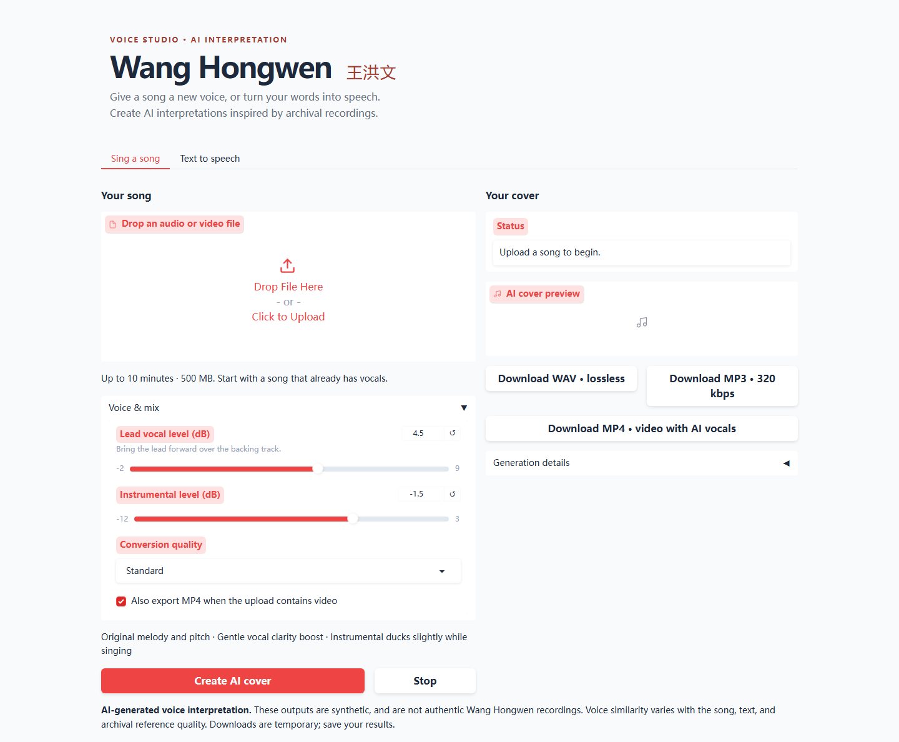

# Wang Hongwen Voice Studio · 王洪文语音工作室

Open-source AI singing conversion and text-to-speech using an archival Wang Hongwen voice reference.

**[Project page and speech sample on Hugging Face](https://huggingface.co/spaces/Little-Wang/wang-hongwen-voice)** · [Validation record](VALIDATION.md) · [Third-party notices](THIRD_PARTY_NOTICES.md) · [GPL-3.0](LICENSE)



## What it does

- **Singing covers:** Upload an existing vocal song or music video. Demucs separates the instrumental, Seed-VC converts the lead, and the app exports a finished mix. WAV and 320 kbps MP3 are included; video uploads can also produce an MP4.
- **Text to speech:** Enter text and generate reference-conditioned speech with Qwen3-TTS 0.6B Base. Chinese is closest to the archival reference; ten languages and automatic language selection are exposed.
- **Vocal-forward defaults:** Original melody and pitch, 40 diffusion steps, gentle EQ/compression, +4.5 dB lead, −1.5 dB backing, and slight instrumental ducking during vocals.
- **Full-song processing:** Overlapping 40-second windows handle songs up to ten minutes by default. The default speech limit is 600 characters; both limits are configurable.

The app uses reference conditioning, without a separately trained Wang Hongwen checkpoint. Outputs are clearly labeled AI-generated. Voice similarity varies with the source and archival recording quality. Instrumental-only input does not invent singing or lyrics.

## Run locally

Start with an NVIDIA CUDA GPU with **16 GB+ VRAM**, Docker, and an NVIDIA-capable Docker runtime. From this repository's root:

```sh
docker build -t wang-voice .
docker run --rm --gpus all -p 7860:7860 wang-voice
```

Open **http://localhost:7860**. The web interface starts without model downloads. The first generation downloads several GB of public weights; completed downloads are cached while the container remains available. No external inference API key is required for the default models.

The singing and Chinese speech pipelines were tested locally on an RTX 5070 Ti with 16 GB VRAM. **The Docker image has not been built or run in the release environment.** See [VALIDATION.md](VALIDATION.md) for the exact checks and deployment limits. The free Hugging Face project page hosts the source and sample; generation runs on the GPU of the machine hosting the downloaded app.

### Python development setup

Use Python 3.12, FFmpeg, SoX, and three separate environments:

1. A web environment with `requirements-ui.txt`.
2. A CUDA PyTorch 2.7.1 / torchaudio 2.7.1 environment with `requirements-singing.txt`.
3. A second CUDA PyTorch / torchaudio environment with `requirements-tts.txt`.

Set `SING_PYTHON` and `TTS_PYTHON` to the full Python executable paths of the two model environments, then run `python app.py` from the web environment. The [Dockerfile](Dockerfile) shows the canonical Linux dependency setup and system packages. Separate environments are necessary because the UI and two model stacks have incompatible Transformers/Hugging Face Hub dependencies.

Run the CPU regression checks from the singing environment with FFmpeg and ffprobe on PATH:

```sh
python -m unittest discover -s tests -v
```

## Configuration

| Variable | Default | Purpose |
|---|---|---|
| `MAX_SONG_SECONDS` | `600` | Song duration limit |
| `MAX_UPLOAD_MB` | `500` | Upload size limit |
| `MAX_TEXT_CHARS` | `600` | Speech text limit |
| `JOB_TIMEOUT_SECONDS` | `7200` | Maximum job runtime, including first downloads |
| `RESULT_TTL_SECONDS` | `3600` | Approximate download retention |
| `MODEL_CACHE` | See Dockerfile | Writable model cache directory |
| `CPU_THREADS` | `4` | PyTorch CPU thread count |

Both tabs share one GPU queue. Each generation runs in a separate process that exits to release GPU memory. Download results before they expire. Processing takes place on the machine hosting the app; the app does not send user audio or text to another inference service or publish outputs to a dataset.

## Project layout

```text
app.py                    Gradio interface
runner.py                 Job queue, cancellation, timeout, cleanup
worker.py                 Singing and speech generation
audio_utils.py            Media validation, mixing, mastering, export
assets/                   Archival reference excerpts and provenance
vendor/seed_vc/           Required upstream inference source and licenses
models.json               Pinned model revisions
tests/                    CPU regression checks
docs/                     Interface preview, sample, HF deployment README
```

For a hosted Docker Space, [docs/SPACE_README.md](docs/SPACE_README.md) contains the required Hugging Face YAML and detailed deployment instructions. Copy it to the root README when deploying that variant. The existing [Hugging Face project page](https://huggingface.co/spaces/Little-Wang/wang-hongwen-voice) is a free Static Space for sharing the source and sample.

## Licenses and attribution

Project software is **GPL-3.0**; see [LICENSE](LICENSE). Required Seed-VC source is vendored with upstream notices and documented cache/reproducibility patches. Seed-VC's checkpoint is GPL-3.0, Qwen3-TTS and its 0.6B Base checkpoint are Apache-2.0, and Demucs is MIT. See [THIRD_PARTY_NOTICES.md](THIRD_PARTY_NOTICES.md) and [models.json](models.json).

The archival WAV references are **excluded from the software license**. This project does not claim ownership of, or grant new redistribution rights to, those recordings. Their derivation and source-file hash are in [assets/reference.json](assets/reference.json). The synthetic welcome sample is in [docs/speech-sample.mp3](docs/speech-sample.mp3).

AI outputs are interpretations, not authentic Wang Hongwen recordings or performances. Preserve the AI-generated label when sharing results.
